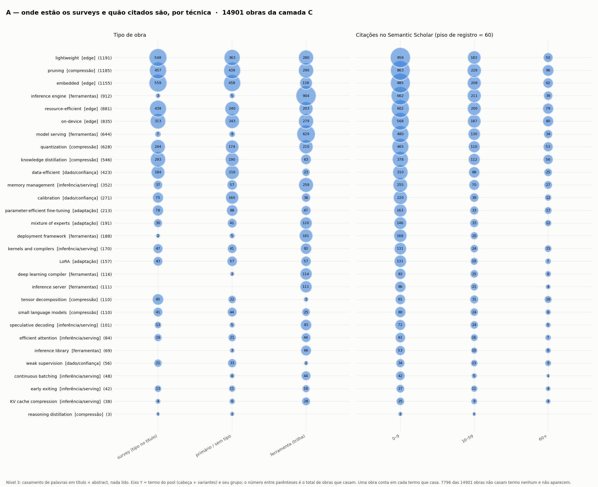
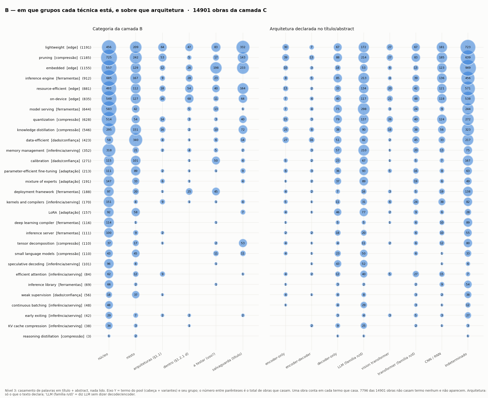

# Bubble plots da camada C (23/09/2026)

**Pedido do Pedro:** *"pode ser só com as facetas que você achar interessante pra ajudar no processo"* —
o processo sendo o desenho da leitura por agentes. Figuras em `figs/`; script em scratchpad
(`bubble_plots.py`); contagens em `figs/bubble_dados.json`.

**Procedência:** nível 3. Tudo é casamento de palavras em título + abstract das **14.901 obras** que
seguiram para a camada C. Nada lido.

## Como ler um bubble plot (Petersen 2008)

Dois painéis lado a lado dividem o mesmo eixo vertical. Cada linha é um **termo do pool** (cabeça +
variantes, com o grupo entre colchetes). Cada bolha é o número de obras que casam aquele termo **e**
aquela categoria da coluna; bolha maior = mais obras. Uma obra que casa três termos conta três vezes.
**7.796 das 14.901 obras não casam termo nenhum do pool** e não aparecem — ver leitura 5.

## A — tipo de obra | citações

*Por que essas facetas:* os agentes vão ler **surveys** (a população do método), e o piso de registro é
**60 citações**. Este plot mostra, por técnica, quantos surveys existem e quantos passariam no piso.

## B — categoria da camada B | arquitetura declarada

*Por que essas facetas:* a categoria da camada B diz **de onde amostrar** para os agentes; a arquitetura
declarada é o eixo que você disse querer aprender (encoder, decoder, encoder-decoder).

## O que os dois mostram (leitura nível 3, a confirmar)

1. **As quatro linhas maiores são de `edge`** (lightweight, embedded, resource-efficient, on-device),
   somando ~4 mil casamentos. É o grupo que mais traz homônimo e IoT; é onde um agente mais vai
   gastar leitura com lixo.
2. **As técnicas de serving de LLM quase não têm survey:** *continuous batching* 0, *inference server*
   0, *deep learning compiler* 0, *KV cache compression* 4, *speculative decoding* 13 surveys. Elas
   vivem em paper de sistema e paper primário (trilha ferramentas). Confirma o achado de 22/09: essa
   parte da área documenta ferramentas, não faz survey delas. Para essas divisões, o "survey" que o
   método pede pode não existir — o seminal (§4) vai ter de vir de paper primário.
3. **Poucas obras passam no piso de 60 citações** em qualquer técnica (a coluna 60+ é sempre a menor);
   nas técnicas recentes de LLM, quase nada — o piso, no registro, vai depender da perna de venue e da
   citação cruzada (§3.2).
4. **A arquitetura quase nunca é declarada:** a coluna "indeterminado" é a maior em quase toda linha.
   Onde há família declarada, **decoder-only / LLM dominam** as técnicas de serving; **encoder-only é
   raro** em todas (máximo 39, em *pruning*). A eficiência de encoder-only — onde o tema v3 mora — é
   pouco documentada em survey.
5. **Metade das obras (7.796) não casa termo do pool.** Elas estão na camada C porque o **assunto**
   (SPECTER2) as pôs perto da área, não por palavra. Ou são lixo semântico, ou são **lacuna de
   vocabulário do pool** — só a leitura (agente ou você) separa. É o argumento mais forte para a
   leitura por amostragem que você propôs.
6. **O grupo "misto" é onde mora o eixo (iii) de §1.2** (*data-efficient* 340, *weak supervision* 37):
   se esse eixo importa, o misto não pode ser descartado em bloco.

## Observação do Pedro (23/09): categorias pequenas

*"Tem categorias com poucos artigos, como 'reasoning distillation', que provavelmente nem têm que passar
por filtragem mais."* Medido sobre as 14.901 (uma obra "pequena" = casa ao menos uma técnica com
poucas obras):

| limite de obras por técnica | técnicas pequenas | obras que casam alguma | das quais surveys | obras que só casam técnicas pequenas |
|---|---|---|---|---|
| <= 50 | 4 (reasoning distillation, KV cache compression, early exiting, continuous batching) | 128 | 18 | 28 |
| <= 100 | 7 (+ weak supervision, inference library, efficient attention) | 333 | 57 | 120 |
| <= 200 | 16 (+ speculative decoding, SLMs, tensor decomposition, inference server, DL compiler, LoRA, kernels, deployment framework, MoE) | 1.439 | 292 | 617 |

**Ainda não é regra** — ideia do Pedro, a promover ou não por ele.

**PROMOVIDA A REGRA pelo Pedro (23/09):** até 20 obras -> **golden ticket** (direto para a última fase);
21 a 50 -> **penúltima filtragem**. Método §11.1 ⟨rev-36⟩. Aplicação: golden = *reasoning distillation*
(3 obras); penúltima = *early exiting* 42, *KV cache compression* 38, *continuous batching* 48 (125
obras, sem as 3 do golden).
