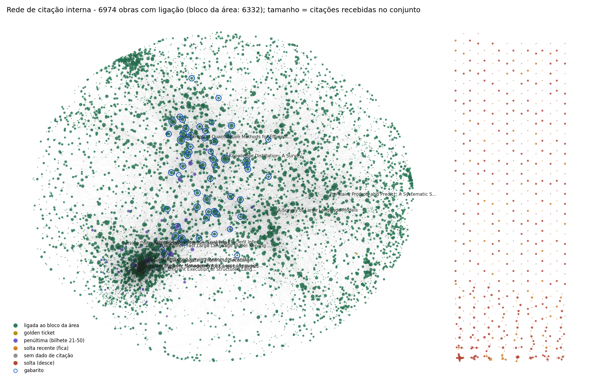
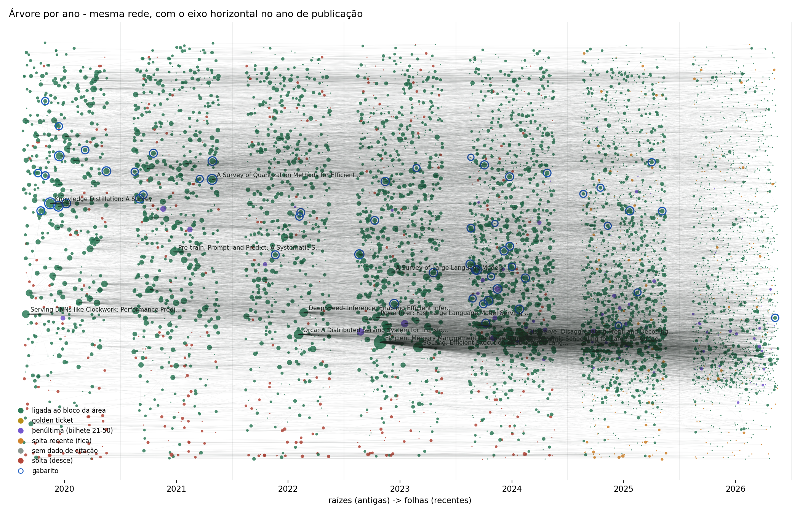

# Árvore de citação - limpeza do retorno da Fase 1

## Para que serve este documento

A execução final da Fase 1 do screening trouxe 118.659 obras das bases Semantic Scholar e arXiv. A
maior parte não é da área: são obras de outros assuntos que usam as mesmas palavras (por exemplo,
"resource-constrained" aparece em escalonamento de projetos, e "lightweight" em concreto leve). Este
documento descreve como reduzi esse volume sem ler obra por obra, e como medi que os cortes não
estavam jogando fora o que eu procuro.

Nada foi apagado. Cada obra carrega, numa tabela única, em que etapa caiu e por quê; o que desce vai
para o fim da fila e pode voltar se aparecer de novo na bola de neve.

## Como medi a perda

Antes de qualquer corte separei uma referência: 58 surveys da execução anterior que classifiquei
como da área pelo título. Sorteei essa referência em duas metades. A metade de ajuste pode ser olhada
para escolher os critérios; a metade de teste só é usada no fim, para medir. Se eu medisse na mesma
metade que olhei, o número sairia otimista.

Fiz isso porque hoje eu não sei reconhecer sozinho um survey importante da área. Preciso de uma
medida que me diga quando um corte está derrubando o que eu procuro.

Limite dessa medida: a referência tem só surveys com 60 ou mais citações, julgados por título. Ela
mede bem os surveys conhecidos e não mede os recentes ou pouco citados.

## As etapas

| etapa | critério | obras que seguem |
|---|---|---|
| retorno da Fase 1 | busca com o pool de termos, sem piso de citação | 118.659 |
| camada A | exclusão por campo de estudo: candidatos foram os 17 campos sem nenhum survey de referência (evidência fraca sozinha, porque a referência é pequena); travas: obra com termo central do pool no título nunca sai (salvou 1.142), amostra de 30 excluídas conferida a olho, perda medida no teste | 74.791 |
| camada B | agrupamento por assunto: título e resumo viram vetor pelo SPECTER2 (encoder BERT treinado em artigos científicos), e o BERTopic agrupa os vetores parecidos em 66 grupos; revisei os grupos um a um e marquei os de outra área, com a mesma salvaguarda do título | 14.901 |
| árvore de citação | obra sem nenhuma ligação por citação com o bloco da área vai para o fim da fila | 11.420 |

Na metade de teste, as três etapas juntas mantiveram 28 de 29 surveys (97%). A única perda foi na
camada A.

## A árvore de citação

### A ideia

Uma área de pesquisa se cita entre si. Um survey de compressão de modelos de linguagem cita, e é
citado por, outros trabalhos de eficiência; um survey de escalonamento de projetos não cita nenhum
deles. Então montei a rede de quem cita quem dentro das 14.901 obras, sem leitura nenhuma, e olhei
se cada obra está ligada ao mesmo bloco em que estão os surveys de referência.

Três exceções foram decididas antes de rodar:

- Obras de técnicas com poucas obras (até 50) não passam por esta etapa; vão direto para as fases de
  leitura;
- Obras de 2025 e 2026 ficam mesmo sem ligação, porque ainda não tiveram tempo de ser citadas;
- Obra sem dado de citação em nenhuma base, e que ninguém do conjunto cita, não desce. Falta de dado
  não é evidência de estar fora da área.

### O problema que encontrei nos dados

Na primeira rodada, o Semantic Scholar devolveu a lista de referências vazia para 9.343 das 14.901
obras (63%), embora o próprio registro dissesse que elas tinham referências. A rede saiu quase sem
ligações, e a maior parte das obras apareceria isolada por falta de dado, não por falta de relação
com a área. Não usei essa rodada.

Investiguei e encontrei duas causas. A consulta em lote escondia referências que a consulta obra a
obra devolve; recoletei as 9.343 uma a uma, e 4.348 vieram. As que continuaram escondidas eram, na
maioria, de editoras (IEEE, Elsevier, ACM), cujas referências o Semantic Scholar não expõe. Juntei
então uma segunda base, o OpenAlex, que expõe as referências dessas editoras e é fraco justamente em
preprints do arXiv, onde o Semantic Scholar é bom. Uma obra cita outra se qualquer das duas bases
disser isso.

| referências vindas de | obras |
|---|---|
| Semantic Scholar e OpenAlex | 3.734 |
| só Semantic Scholar | 3.756 |
| só OpenAlex | 4.417 |
| nenhuma base | 2.994 |

### O que a rede mostrou

- 20.222 ligações entre as 14.901 obras;
- Um bloco dominante de 6.332 obras. O segundo maior tem 21. Fora do bloco há 258 ilhas pequenas
  (642 obras) e 7.927 obras sem nenhuma ligação;
- 27 dos 28 surveys de ajuste estão no bloco dominante. O 28º pulou esta etapa por ser de técnica com
  poucas obras;
- Dentro do bloco aparece um núcleo denso de sistemas de serving (Orca, gerenciamento de memória de
  atenção, SGLang), e os surveys de referência se concentram na região de compressão.

### Resultado

| destino | obras |
|---|---|
| ligada ao bloco da área | 6.228 |
| sem ligação, mas de 2025-26 (fica) | 2.350 |
| sem dado de citação (fica) | 2.714 |
| técnica com poucas obras (pula para a leitura) | 128 |
| sem ligação (desce para o fim da fila) | 3.481 |

Na metade de teste, 28 de 28 surveys que chegaram a esta etapa continuaram ligados ao bloco.

As obras mais citadas entre as que desceram são quase todas de outras áreas: rastreamento de
potência em painel solar, escalonamento de projetos, desenvolvimento ágil, concreto leve, rádio LoRa.
Numa amostra aleatória de 25, porém, apareceram cerca de 3 casos de borda (hardware de inferência
analógico, rede embarcada para imagem médica, detecção em dispositivos IoT). Por isso as obras que
descem ficam no fim da fila, e não fora do screening.

## O que vem depois

As obras que seguem passam pela leitura com agentes, descrita no documento Desenho da Leitura por
Agentes: amostragem por grupo, keywording e, por fim, leitura completa com a minha decisão sobre
cada obra.
