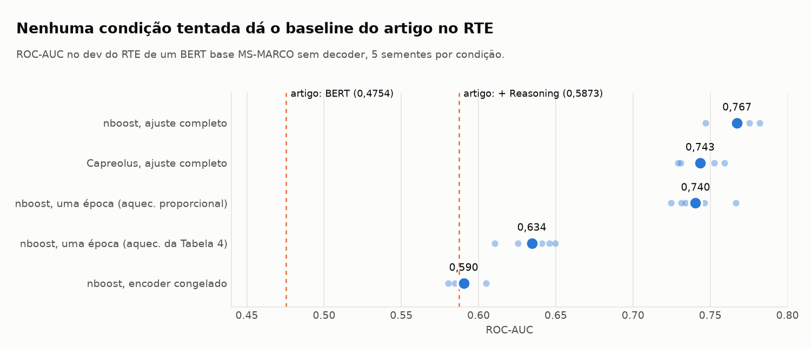
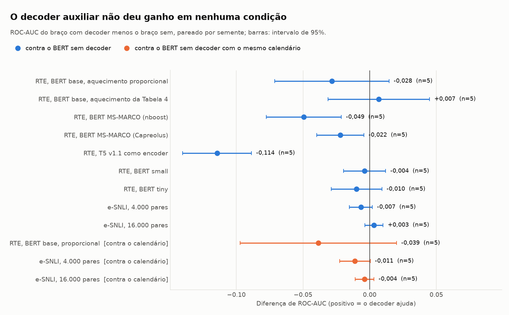
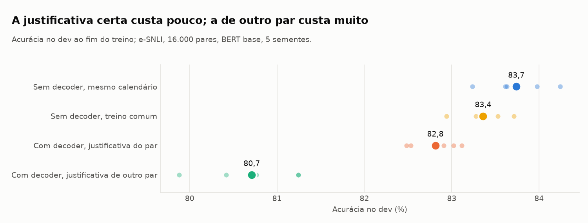
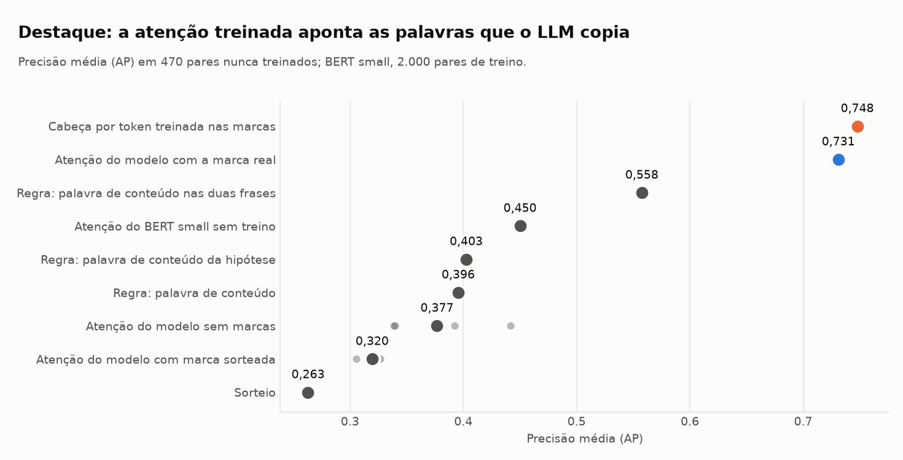
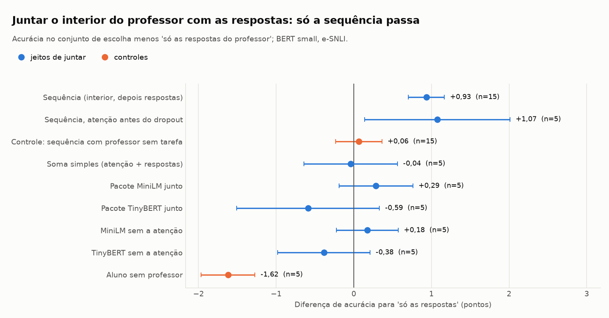
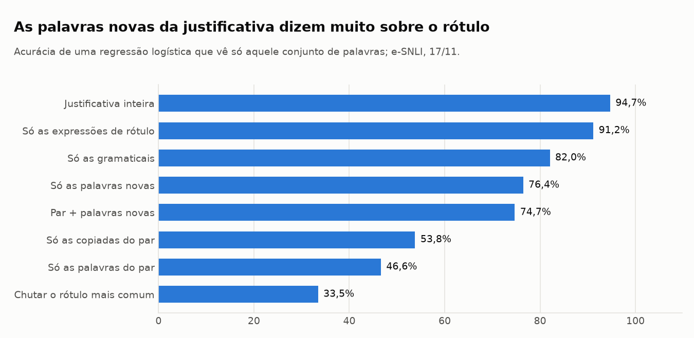
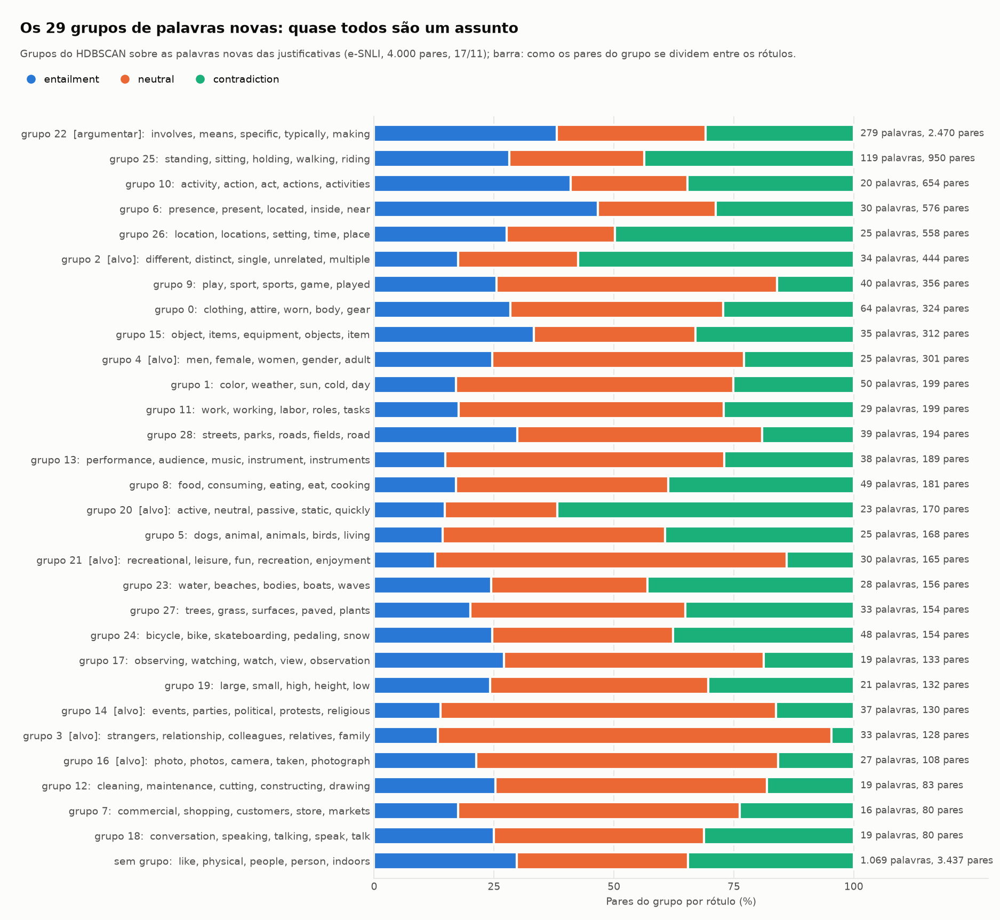
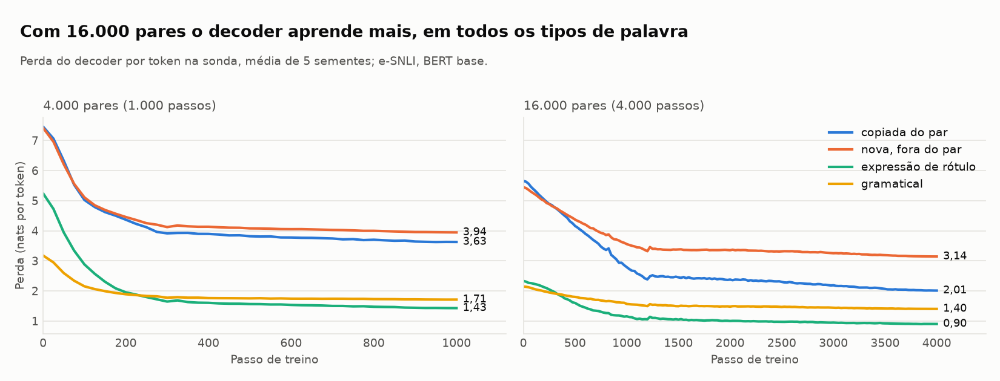

# Figuras e Evidencias da Semana 10

Este documento junta as provas do que o termo da Semana 10 afirma: as figuras dos resultados e a lista de onde está cada número. Todas as figuras são geradas por script a partir dos arquivos de resultado, sem número digitado à mão. As diferenças são pareadas por semente e as barras são intervalos de 95%.

## 1. Onde está cada prova

Como ler: cada linha é uma afirmação do termo, o arquivo do projeto que a sustenta e o que há nele.

| Afirmação do termo | Arquivo | O que há nele |
|---|---|---|
| O critério de cada teste foi escrito antes de rodar | docs/2026-11-18-gaps-da-argumentacao.md (Gaps 1 a 9) e docs/2026-11-10-plano-teste-fora-da-distribuicao.md | a regra de leitura de cada rodada, com data e hora, antes do resultado |
| O número do artigo não saiu | resultados/rte-msmarco/leitura-grade.md e resultados/rte-capreolus/leitura-grade.md | as condições tentadas para o baseline e o que cada uma deu |
| Calendário, justificativa trocada, curva de arranque | resultados/esnli-treino-16k/leitura-grade.md, itens 1 a 23 | tabelas com média, intervalo e contagem de sementes |
| Fora do domínio, as quatro medidas e o peso do decoder | o mesmo arquivo, itens 24 a 44 | idem, com as conferências do instrumento |
| Marcas de atenção, destilação, professor que lê a justificativa | resultados/rte-pequenos/leitura-grade.md | idem |
| Os números brutos | resultados/*/pc/resultados.csv e resultados/*/amigo/resultados.csv | uma linha por braço e semente, como o treino gravou |
| As contas das tabelas | resultados/esnli-treino-16k/ler_fora.py e ler_peso.py; resultados/figuras/graficos_projeto.py | scripts que leem os CSVs e imprimem as diferenças e os intervalos |
| O código dos treinos e os testes | src/radibert/ e tests/ | 209 testes automáticos passando em 19/11 |

O código desta Semana está no meu computador e ainda não foi enviado ao repositório remoto.

## 2. O ponto de partida

## 3. Os controles nos 16 mil pares

## 4. Fora do domínio, outras medidas e o peso do decoder

![Figura 5. À esquerda, o braço com decoder menos o braço sem decoder com o mesmo calendário, em pontos, dentro do domínio, fora dele e nas medidas do painel (na calibração o sinal foi invertido, para que à direita seja sempre melhor). À direita, a mesma diferença de acurácia no dev para cada peso da perda do decoder; os pesos 0, 0,05 e 0,5 têm 3 sementes e o 0,1 tem 5. A figura usa a rodada de 19/11, em que o decoder fica 0,8 ponto abaixo no dev; na rodada de 18/11, com as mesmas sementes, a diferença foi de 0,9.](../resultados/figuras/30-fora-de-dominio-painel-e-peso.png)

## 5. O que funciona no mesmo cenário

## 6. Uma hipótese para a falta de ganho: as justificativas que eu gerei

Uma explicação que não testei é que a falta de ganho venha das justificativas, e não da receita. No artigo de Agrawal, Ahemad & Sembium (2025) a tarefa é de comércio eletrônico, e lá a justificativa pode trazer conhecimento do domínio que não está no par. Nas minhas, geradas com o Qwen para inferência textual, o que medi indica que a justificativa quase só repete o rótulo e o assunto do par, coisas que o encoder já recebe ou já tem. Não vi as justificativas do artigo, que não publica o prompt, então isto é hipótese.

Como ler: cada linha é uma medida feita sobre as justificativas que gerei, o número e o que ele indica. "Palavras novas" são as que estão na justificativa e não estão no par; "copiadas" são as que vêm do par; "expressões de rótulo" são as que só aparecem com um rótulo.

| Medida | Resultado | O que indica |
|---|---|---|
| De que é feita a justificativa no e-SNLI (16 mil pares, parcela das palavras) | gramaticais 45,8%; novas 21,8%; expressões de rótulo 17,2%; copiadas do par 15,2% | pouco mais de um quinto do texto é palavra nova |
| O mesmo no RTE | gramaticais 44,2%; copiadas do par 33,2%; novas 13,5%; expressões de rótulo 9,1% | no RTE a justificativa copia mais e acrescenta menos |
| Adivinhar o rótulo só com as palavras novas (regressão, 4.000 pares, 3 classes) | 76,4%, contra 33,5% do acaso, 46,6% com as palavras do par e 53,8% com as copiadas | o que a justificativa traz de novo é, em boa parte, o próprio rótulo |
| Agrupamento das 2.323 palavras novas | 1 grupo de palavras de argumentar (279 palavras, em 2.470 dos 4.000 pares), 28 grupos de assunto e 1.069 palavras sem grupo | o resto do que é novo é argumento genérico e o assunto do par |
| Um BERT que lê só a justificativa, sem o par | acerta 96,9%; lendo só o par, 78,4% | a justificativa entrega o rótulo |
| Forma por rótulo | "simultaneous" em 44,8% das justificativas de contradição; "not necessarily" em 17,7% das de neutro | a forma do texto é previsível pelo rótulo |
| Perda do decoder no fim do treino, por tipo de palavra (menor é melhor) | expressões de rótulo 0,90; gramaticais 1,40; copiadas 2,01; novas 3,14 | o decoder aprende bem a forma e mal o conteúdo novo |

O que isso sustenta: nas minhas justificativas, a informação nova é pouca e está muito ligada ao rótulo, que o classificador já recebe na própria perda de classificação. Isso combina com o decoder não acrescentar nada ao encoder. O que não sustenta: que as justificativas do artigo sejam diferentes das minhas, porque não as vi; nem que um domínio em que a justificativa traga informação ausente do par daria ganho, porque não testei. Para testar seria preciso repetir o treino num domínio assim e medir as mesmas parcelas de palavras dos dois lados. A hipótese também tem um limite que já se vê: o artigo relata ganho no RTE (+0,112), que é um conjunto de domínio geral como os meus, e isso ela não explica.

## 7. Uso de LLM

As figuras, os scripts que as geram e a leitura dos resultados foram feitos com LLM (Claude). As decisões sobre o que medir estão descritas no documento principal.
